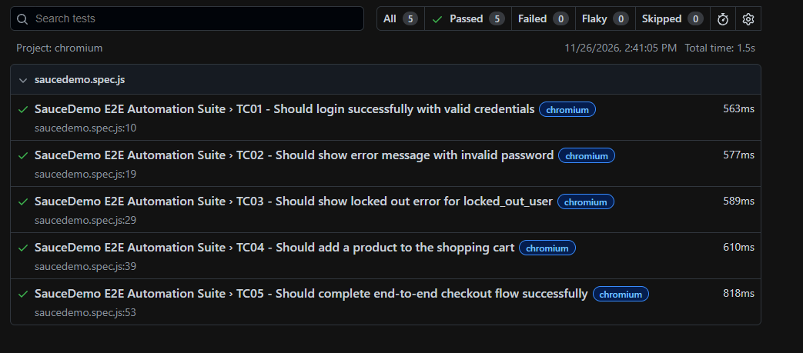
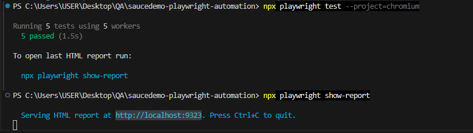

# 🎭 SauceDemo End-to-End Web UI Test Automation Framework

[](https://playwright.dev/)
[-F7DF1E?style=flat-square&logo=javascript&logoColor=black)](https://nodejs.org/)
[](https://github.com/features/actions)

An automated end-to-end (E2E) UI regression test suite built with **Playwright** and **JavaScript** for the [SauceDemo](https://www.saucedemo.com/) e-commerce web application. This framework validates critical user journeys including authentication, negative error handling, shopping cart state management, and checkout completion.

---

## 📋 Table of Contents
- [Architecture & Tech Stack](#-architecture--tech-stack)
- [Project Structure](#-project-structure)
- [Automated Test Scenarios](#-automated-test-scenarios)
- [Prerequisites & Setup](#-prerequisites--setup)
- [Test Execution Commands](#-test-execution-commands)
- [Test Execution Evidence](#-test-execution-evidence)
- [CI/CD Integration](#-cicd-integration)

---

## 🛠️ Architecture & Tech Stack

* **Automation Framework:** Playwright Test (`@playwright/test`)
* **Programming Language:** JavaScript (CommonJS / Node.js)
* **Locator Strategy:** Resilient `data-test` attribute selectors (`[data-test="..."]`) to prevent brittle UI test failures
* **Assertion Engine:** Playwright built-in web-first auto-waiting assertions (`expect`)
* **Reporting:** Interactive HTML Test Reporter with failure trace/screenshot capture
* **CI/CD Pipeline:** GitHub Actions automated workflow on push and pull requests

---

## 📂 Project Structure

```text
saucedemo-playwright-automation/
├── .github/
│   └── workflows/
│       └── playwright.yml          # GitHub Actions CI/CD workflow configuration
├── screenshots/
│   ├── playwright-html-report.png  # HTML test execution report evidence
│   └── terminal-execution.png      # CLI test runner output evidence
├── tests/
│   └── saucedemo.spec.js           # Core E2E functional & regression test suite
├── .gitignore                      # Excludes node_modules, test-results, and reports
├── package.json                    # Project metadata and Playwright dependencies
├── package-lock.json               # Locked dependency versions
├── playwright.config.js            # Playwright browser, timeout, and reporter settings
└── README.md                       # Project documentation
```

---

## 🧪 Automated Test Scenarios

| Test ID | Test Case Title | Test Type | Preconditions | Expected Result | Status |
| :--- | :--- | :--- | :--- | :--- | :--- |
| **TC01** | Valid User Authentication | Positive / Smoke | User is on the SauceDemo login page | Redirects to `/inventory.html` and renders the `Products` header | ✅ Pass |
| **TC02** | Invalid Password Validation | Negative | Valid username (`standard_user`) with incorrect password | Blocks login and displays *"Username and password do not match"* error banner | ✅ Pass |
| **TC03** | Locked-Out Account Handling | Negative / Security | User enters `locked_out_user` credentials | Denies access and displays *"Sorry, this user has been locked out"* message | ✅ Pass |
| **TC04** | Add Product to Shopping Cart | Functional | User is authenticated on the inventory page | Cart badge increments to `1` and `Sauce Labs Backpack` persists in `/cart.html` | ✅ Pass |
| **TC05** | Complete End-to-End Checkout Flow | E2E / Critical Path | User adds `Sauce Labs Bike Light` to cart | Completes shipping details, finishes order, and displays *"Thank you for your order!"* | ✅ Pass |

---

## ⚙️ Prerequisites & Setup

Ensure the following tools are installed on your local machine:
* **Node.js** (v18.x or higher)
* **npm** (v9.x or higher)
* **Git**

### Local Installation

1. **Clone the repository:**
   ```bash
   git clone https://github.com/samithatharanga/saucedemo-playwright-automation.git
   cd saucedemo-playwright-automation
   ```

2. **Install project dependencies:**
   ```bash
   npm install
   ```

3. **Install Playwright browser binaries:**
   ```bash
   npx playwright install
   ```

---

## 🚀 Test Execution Commands

| Action | Command |
| :--- | :--- |
| **Run all tests (Headless across all browsers)** | `npx playwright test` |
| **Run tests on Chromium only** | `npx playwright test --project=chromium` |
| **Run tests in Headed mode (Visible browser)** | `npx playwright test --project=chromium --headed` |
| **Run tests in Interactive UI Mode** | `npx playwright test --ui` |
| **Open the HTML Execution Report** | `npx playwright show-report` |

---

### 1. Playwright HTML Test Report


### 2. CLI Test Runner Output


## 🔄 CI/CD Integration

This repository includes a pre-configured **GitHub Actions** pipeline (`.github/workflows/playwright.yml`). On every `push` or `pull_request` to the `main` branch, the workflow automatically provisions an Ubuntu runner, installs dependencies and Playwright browsers, executes the full regression test suite, and uploads the HTML report as a build artifact.

---

## 👤 Author

**Samitha Tharanga Wijesinghe**  
B.Sc. (Hons) in Information Technology Undergraduate | Aspiring QA & Test Automation Engineer  
- **GitHub:** [@samithatharanga](https://github.com/samithatharanga)
